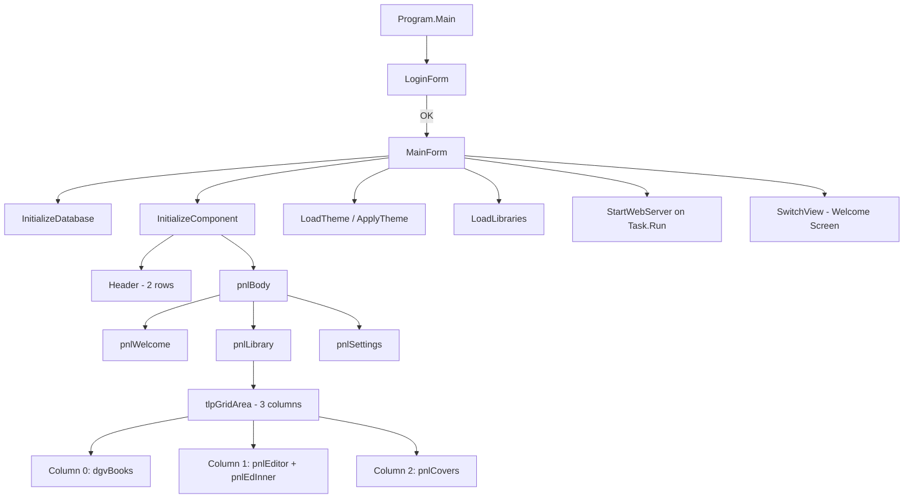

# My K Library — Programmer Documentation
**Version:** 3.6.3 · **Language:** VB.NET (VB 2012 / .NET 4.5) · **UI:** WinForms · **DB:** MS Access (Jet 4.0)

---

## Table of Contents
1. [Project Overview](#1-project-overview)
2. [File Structure](#2-file-structure)
3. [Build & Compile](#3-build--compile)
4. [Architecture Overview](#4-architecture-overview)
5. [Class Inventory](#5-class-inventory)
6. [Database Schema](#6-database-schema)
7. [UI Layout System](#7-ui-layout-system)
8. [Header (2-Row Navigation Bar)](#8-header-2-row-navigation-bar)
9. [Theme Engine](#9-theme-engine)
10. [Inline Book Editor](#10-inline-book-editor)
11. [AI / ISBN Lookup](#11-ai--isbn-lookup)
12. [Web Server Module](#12-web-server-module)
13. [Role-Based Access Control](#13-role-based-access-control)
14. [Key Methods Reference](#14-key-methods-reference)
15. [State Variables Reference](#15-state-variables-reference)
16. [Adding a New Feature — Checklist](#16-adding-a-new-feature--checklist)

---

## 1. Project Overview

My K Library is a single-executable Windows desktop application for personal book collection management. It stores records in a local MS Access `.mdb` database and exposes a lightweight HTTP dashboard on `localhost:8080`.

**Key capabilities:**
- Multi-library management (create, rename, delete, merge)
- Inline CRUD editor for books (no popups)
- AI-powered ISBN lookup via Google Gemini API
- Barcode scanner / manual ISBN lookup via Google Books + ISBNSearch.org
- CSV export, image harvesting (web → local)
- 4-theme skin system (Clean Charcoal / Dark Mode / Warm Parchment / Modern Cool)
- Built-in HTTP web dashboard
- Role-based access (SuperAdmin / Administrator / Editor / Viewer)

---

## 2. File Structure

```
my K Library\
├── Program.vb            ← Entire application source (single file)
├── LibraryApp.vbproj     ← MSBuild project file (targets .NET 4.5, x86)
├── Solution1.sln         ← Visual Studio solution
├── build_vb.bat          ← One-click compile script
├── Library.mdb           ← Access database (auto-created on first run)
├── db_config.txt         ← Active connection string (auto-generated)
├── window_size.txt        ← (legacy, unused)
├── grid_layout.txt        ← (legacy, unused)
├── bookic1.png           ← App logo (optional, loaded at runtime)
├── bookic2.ico           ← App icon
├── BookImages\           ← Locally downloaded cover/back images
└── bin\Release\          ← Compiled output
    └── LibraryAppVB.exe
```

> [!IMPORTANT]
> All application logic lives in a **single file** (`Program.vb`). There are no separate form files or designer files.

---

## 3. Build & Compile

### Quick build
Double-click **`build_vb.bat`** in the project folder.

### Manual command
```bat
"C:\Windows\Microsoft.NET\Framework\v4.0.30319\vbc.exe" ^
    /target:winexe ^
    /platform:x86 ^
    /win32icon:bookic2.ico ^
    /out:LibraryAppVB.exe ^
    /reference:System.dll,System.Data.dll,System.Drawing.dll, ^
               System.Windows.Forms.dll,System.Xml.dll, ^
               System.Core.dll,Microsoft.VisualBasic.dll ^
    Program.vb
```

> [!WARNING]
> The app must be **closed** before recompiling — the compiler cannot overwrite a running executable (error `0x80070020`).

### Compiler notes
- Targets **VB 2012** (vbc.exe v14) — avoid VB 14+ syntax (`?.`, `$""` interpolation, `NameOf`)
- Platform is **x86** — required for the 32-bit Jet 4.0 OLEDB driver used with `.mdb`
- **No designer file** — the entire `InitializeComponent()` is handwritten code

---

## 4. Architecture Overview



### Startup sequence (constructor `MainForm.New`)
| # | Call | Purpose |
|---|------|---------|
| 1 | `LoadConnectionSettings()` | Read/create `db_config.txt` |
| 2 | `InitializeDatabase()` | CREATE TABLE / ALTER TABLE (idempotent) |
| 3 | `InitializeComponent()` | Build all UI controls in code |
| 4 | `SetBrowserEmulation()` | Registry: IE11 mode for WebBrowser control |
| 5 | `LoadTheme()` + `ApplyTheme()` | Read saved skin, paint controls |
| 6 | `UpdateUIState()` | Apply lock + role permissions |
| 7 | `LoadLibraries()` | Populate library combobox |
| 8 | `LoadGridLayout()` | Restore saved column widths |
| 9 | `InitRandomGradient()` | Pick welcome screen gradient |
| 10 | `SwitchView("Welcome Screen")` | Show initial panel |
| 11 | `Task.Run(StartWebServer)` | Background HTTP server |

---

## 5. Class Inventory

| Class | Location | Purpose |
|-------|----------|---------|
| `MainForm` | Lines 19–2450 | Main application window — all primary logic |
| `IsbnPreviewForm` | Lines 2453–2491 | Preview dialog after ISBN barcode scan |
| `MetadataSelectForm` | Lines 2494–2551 | Checkbox list to cherry-pick AI metadata fields |
| `ColumnOrderDialog` | Lines 2554–2613 | Drag-to-reorder grid columns |
| `DatabaseSettingsDialog` | Lines 2616–2681 | Switch between Access / SQL Server connection |
| `LoginForm` | Lines 2688–2789 | Authentication form (username + password) |
| `UserManagerDialog` | Lines 2791–2836 | SuperAdmin user provisioning |
| `Program` (Module) | Lines 2838–2861 | `Sub Main()` entry point; stores `SessionUser`, `SessionRole` |

---

## 6. Database Schema

### Table: `Books`
| Column | Type | Notes |
|--------|------|-------|
| `ID` | COUNTER (PK) | Auto-increment |
| `Title` | VARCHAR(255) | Required |
| `Author` … `Author10` | VARCHAR(255) | Up to 10 authors |
| `CoAuthors` | VARCHAR(255) | Legacy combined field |
| `CategoryID` | INTEGER | FK → Categories (if used) |
| `Genre` | VARCHAR(255) | Text category backup |
| `Pages` | INTEGER | |
| `PubYear` | INTEGER | |
| `Publisher` | VARCHAR(255) | |
| `ISBN` | VARCHAR(50) | |
| `CopyNum` | INTEGER | |
| `Series` | VARCHAR(255) | |
| `Language` | VARCHAR(50) | |
| `Weight` | VARCHAR(50) | |
| `Dimensions` | VARCHAR(100) | |
| `LCCN` / `OCLC` | VARCHAR(50) | Library catalog numbers |
| `Subjects` | MEMO | |
| `Description` | MEMO | Summary / back-cover text |
| `CoverPath` | VARCHAR(255) | Local path or HTTP URL |
| `BackPath` | VARCHAR(255) | Local path or HTTP URL |
| `LibraryName` | VARCHAR(255) | Partition key for multi-library |
| `AddedBy` | VARCHAR(50) | Session username on insert |
| `EditedBy` | VARCHAR(50) | Session username on update |

### Table: `Libraries`
| Column | Type | Notes |
|--------|------|-------|
| `LibName` | VARCHAR(255) PK | Library name = partition key |

### Table: `Settings`
| Column | Type | Notes |
|--------|------|-------|
| `KeyName` | VARCHAR(255) PK | Setting identifier |
| `SettingValue` | VARCHAR(255) | Setting value |

**Known `Settings` keys:**
| Key | Values | Purpose |
|-----|--------|---------|
| `ResolutionMode` | `Small` / `Medium` / `Large` | UI density |
| `AppTheme` | `Clean Charcoal` / `Dark Mode` / `Warm Parchment` / `Modern Cool` | Active skin |

### Table: `Users`
| Column | Type | Notes |
|--------|------|-------|
| `UserID` | COUNTER (PK) | |
| `Username` | VARCHAR(50) | |
| `Password` | VARCHAR(50) | Plaintext (no hashing) |
| `Role` | VARCHAR(20) | `SuperAdmin` / `Administrator` / `Editor` / `Viewer` |

> [!CAUTION]
> Passwords are stored in **plaintext** in the database. Do not deploy on a shared network without upgrading the authentication layer.

---

## 7. UI Layout System

### Top-level control tree
```
MainForm
├── pnlHeader  (Dock=Top, 92px)  ← 2-row navigation bar
└── pnlBody    (Dock=Fill)
    ├── pnlWelcome   (Fill, z-order toggled by SwitchView)
    ├── pnlLibrary   (Fill, z-order toggled by SwitchView)
    └── pnlSettings  (Fill, z-order toggled by SwitchView)
```

### pnlLibrary internal structure
```
pnlLibrary (Fill)
├── pnlLibTop    (Dock=Top, 40px)  ← "Currently Viewing: X" title
├── pnlLockRow   (Dock=Top, 44px)  ← Lock button + selected book ID label
├── pnlScanRow   (Dock=Top, 46px)  ← ISBN input + Lookup + AI Lookup
└── tlpGridArea  (Dock=Fill, TableLayoutPanel 3 columns)
    ├── Col 0 (Percent 100%): dgvBooks
    ├── Col 1 (Absolute 340px): pnlEditor → pnlEdInner (scrollable)
    └── Col 2 (Absolute 220px): pnlCovers (Cover + Back PictureBoxes)
```

### View switching (`SwitchView`)
Shows/hides panels by toggling `.Visible` and calling `.BringToFront()`. Accepted values: `"Welcome Screen"`, `"View Current Books"`, `"Settings"`.

### Resolution modes (`resolutionMode`)
Applied by `ApplyResolutionSize()` which calls `LoadResolutionMode()` on startup.

| Mode | Form Size | Font |
|------|-----------|------|
| `Small` | 900 × 600 | 8.5pt |
| `Medium` | 1100 × 720 | 10pt |
| `Large` | 1400 × 900 | 11.5pt |

---

## 8. Header (2-Row Navigation Bar)

**`pnlHeader`** — `Dock=Top`, height = **92px**, `BackColor` = theme header colour.

### Row 1 — `pnlHdrRow1` (Dock=Top, 46px)
Controls added in code (absolute positions):
- `picLogo` — 34×34 px book icon (`bookic1.png`)
- `lblTitle` — "My K Library" bold label
- `lblNav` + `cmbNavigation` — view selector dropdown

### Row 2 — `pnlHdrRow2` (Dock=Bottom, 46px, `AutoScroll=True`)
A `FlowLayoutPanel` (`flpHeader`) with `Dock=Left` inside, so buttons never wrap but a **horizontal scrollbar** appears if the window is too narrow.

**Button order (left → right):**
1. `+ Library` — `AddLibrary`
2. `✎ Rename` — `RenameLibrary`
3. `✖ Del Lib` — `DeleteLibrary`
4. `🔗 Merge` — `MergeLibraries`
5. *(separator panel, 1px)*
6. `⚙ DB` — `OpenDbSettingsDialog`
7. `📑 Style` — `OpenColumnOrderDialog`
8. `📥 Harvest` — `BatchHarvestImages`
9. `📊 Export` — `ExportBooksToCsv`
10. `🌐 Web` — launches `http://localhost:8080`
11. `A+` / `A-` — `IncreaseFont` / `DecreaseFont`
12. `👤 Users` — `UserManagerDialog` *(SuperAdmin only)*

> [!TIP]
> Library management buttons (Add/Rename/Delete/Merge) live in the **header row 2**, not on `pnlWelcome`. This makes them always accessible regardless of which view is active.

---

## 9. Theme Engine

### Fields
```vb
Private currentTheme As String = "Clean Charcoal"
Private pnlHeader As Panel    ' promoted to field for ApplyTheme
Private pnlBody As Panel
Private pnlScanRow As FlowLayoutPanel
Private pnlLockRow As FlowLayoutPanel
Private pnlLibTop As Panel
```

### Methods

| Method | Purpose |
|--------|---------|
| `LoadTheme()` | Reads `AppTheme` key from `Settings` table |
| `SaveTheme()` | Writes `currentTheme` to `Settings` via `UpsertSetting()` |
| `ApplyTheme()` | Resolves palette and sets `BackColor`/`ForeColor` on all themed controls |
| `GetThemeAccent()` | Returns the accent `Color` used in Settings headings |

### Adding a new theme
1. Add a new `Case "Theme Name"` block inside `ApplyTheme()` assigning all palette variables
2. Add the theme name + emoji + subtitle + accent colour to the parallel arrays in `BuildSettingsPanel()`
3. That's it — the UI rebuilds automatically

### Palette variables resolved in `ApplyTheme()`
| Variable | Target |
|----------|--------|
| `headerBG` | `pnlHeader.BackColor` |
| `bodyBG` | `pnlBody`, `pnlWelcome`, `pnlLibrary`, `pnlSettings` |
| `toolbarBG` | `pnlScanRow`, `pnlLockRow` |
| `editorBG` | `pnlEditor`, `pnlEdInner` |
| `libTopBG` | `pnlLibTop` |
| `gridHdrBG/FG` | `dgvBooks.ColumnHeadersDefaultCellStyle` |
| `gridBG` | `dgvBooks.DefaultCellStyle.BackColor` |
| `saveBtnBG` | `btnEdSave` |
| `deleteBtnBG` | `btnEdDelete` |
| `newBtnBG` | `btnEdNew` |
| `lockBtnBG` | `btnToggleLock` (when locked) |
| `titleFG` | `lblLibraryViewTitle.ForeColor` |

---

## 10. Inline Book Editor

The editor replaces all popup `BookForm` dialogs. It lives in **Column 1** of `tlpGridArea`.

### Control hierarchy
```
pnlEditor (Panel, Dock=Fill, BorderStyle=FixedSingle)
│   Carries Enabled state (lock toggle disables entire tree)
├── VScrollBar (edScrollBar, Dock=Right, Width=26px ≈ 150% standard)
└── pnlEdInner (Panel, fixed height = content height ~640px)
    ├── txtEdISBN    (Read-only, shows DB record ID)
    ├── txtEdTitle
    ├── txtEdAuthor
    ├── txtEdYear / txtEdPages  (side-by-side)
    ├── txtEdCategory
    ├── txtEdSummary  (multiline, 80px)
    ├── txtEdCoverUrl
    ├── txtEdBackUrl
    ├── btnEdSave     → InlineSave()
    ├── btnEdNew      → InlineNew() → ClearEditorFields()
    ├── btnEdDelete   → InlineDelete()
    └── btnEdSearchOnline → OpenSearchOnline()
```

### Scrolling mechanism
- `pnlEdInner.Height` is fixed at `edY + 20` after all controls are added
- On `pnlEditor.Resize`: recalculates `edScrollBar.Maximum = contentH - visibleH + LargeChange - 1`
- On `edScrollBar.Scroll`: `pnlEdInner.Top = -edScrollBar.Value`

### Lock mechanism (`isLocked`)
- Default: **locked** (`isLocked = True`)
- `btnToggleLock.Click` → `ToggleLock()` → prompts password (`AppPassword = "admin123"`) → sets `pnlEditor.Enabled`
- `UpdateUIState()` also sets `pnlEditor.Enabled = Not isLocked`

### CRUD flow

| Action | Entry point | DB operation |
|--------|-------------|-------------|
| Select row | `dgvBooks_SelectionChanged` | `SELECT` (already in DataTable) |
| Save existing | `InlineSave` | `UPDATE Books SET ... WHERE ID=?` |
| Save new | `InlineSave` → `InlineInsert` | `INSERT INTO Books ...` |
| Clear for new | `InlineNew` / `ClearEditorFields` | None |
| Delete | `InlineDelete` | `DELETE FROM Books WHERE ID=?` |

> [!NOTE]
> `ClearEditorFields()` is separate from `InlineNew()` so that automated callers (AI lookup, post-delete reset) can bypass the lock check.

---

## 11. AI / ISBN Lookup

### Gemini AI Lookup (`GeminiIsbnLookup`)
Triggered by `btnAiLookup` in `pnlScanRow`.

**Flow:**
1. Read ISBN from `txtScannerInput`
2. POST to `https://generativelanguage.googleapis.com/v1beta/models/gemini-pro:generateContent`
3. Parse JSON response with `GeminiExtractField(json, key)` — custom regex extractor
4. Navigate to "View Current Books" if not already there
5. Call `ClearEditorFields()` then fill `txtEdTitle`, `txtEdAuthor`, `txtEdYear`, `txtEdPages`, `txtEdSummary`
6. Show guidance message — user reviews and clicks 💾 Save Changes

**API key:** Currently hardcoded in the method. Search for `"AIza"` in `GeminiIsbnLookup` to locate it.

### Barcode / Manual ISBN Lookup (`SearchByIsbn`)
Triggered by `btnScanSearch`. Two-step fallback:

1. **Google Books API** — `https://www.googleapis.com/books/v1/volumes?q=isbn:{isbn}` (JSON, high reliability)
2. **ISBNSearch.org scrape** — regex on raw HTML (fallback)
3. If not found → offer to open Google in Edge App Mode
4. If found → `ClearEditorFields()` + fill editor fields

### `GeminiExtractField(json, key)`
Custom field extractor — searches for `"key": "value"` patterns in raw JSON using `Regex.Match`.

---

## 12. Web Server Module

**`StartWebServer()`** runs on a background `Task` (thread pool). Listens on `http://localhost:8080/`.

### Routes

| URL | Handler | Response |
|-----|---------|---------|
| `GET /` | `GetWebDashboardHtml()` | HTML dashboard page |
| `GET /api/books` | `GetBooksJson()` | JSON array of books |
| Any other | Inline 404 | Plain text error |

### `GetBooksJson()`
Queries `Books` table filtered by `currentLibrary`, serialises each row as a flat JSON object with `ID`, `Title`, `Author`, `PubYear`, `CoverPath`.

### `GetWebDashboardHtml()`
Returns a static HTML page that fetches `/api/books` via JavaScript `fetch()` and renders a card grid. Fully self-contained (no external CDN).

> [!TIP]
> To add a new API endpoint, add an `ElseIf request.Url.AbsolutePath = "/api/newroute"` branch inside `HandleWebRequest()`.

---

## 13. Role-Based Access Control

Roles are set at login and stored in `Program.SessionRole`.

| Role | Library Mgmt | Add Book | Edit Book | Delete Book | Delete Library | Users |
|------|:---:|:---:|:---:|:---:|:---:|:---:|
| `SuperAdmin` | ✅ | ✅ | ✅ | ✅ | ✅ | ✅ |
| `Administrator` | ✅ | ✅ | ✅ | ✅ | ✅ | ❌ |
| `Editor` | ✅ | ✅ | ✅ | ❌ | ❌ | ❌ |
| `Viewer` | ❌ | ❌ | ❌ | ❌ | ❌ | ❌ |

Enforced in `UpdateUIState()` by disabling buttons and the editor panel.

---

## 14. Key Methods Reference

| Method | Line | Description |
|--------|------|-------------|
| `InitializeComponent()` | ~285 | Builds entire UI in code |
| `SwitchView(name)` | ~920 | Shows/hides pnlWelcome/pnlLibrary/pnlSettings |
| `LoadBooks()` | 1758 | Queries DB, binds to `dgvBooks` |
| `dgvBooks_SelectionChanged` | 1780 | Row click → fills inline editor |
| `InlineSave` | 1810 | UPDATE or INSERT based on empty txtEdISBN |
| `InlineNew` | 1873 | Lock-gated — calls `ClearEditorFields()` |
| `InlineInsert` | 1882 | INSERT new book from editor fields |
| `InlineDelete` | 1914 | DELETE selected book with confirm dialog |
| `ClearEditorFields` | 1856 | Resets all editor TextBoxes (bypasses lock) |
| `ApplyTheme` | ~975 | Applies full colour palette to all themed controls |
| `BuildSettingsPanel` | ~756 | Rebuilds settings page (theme + resolution cards) |
| `UpdateUIState` | 1304 | Syncs lock state + role permissions across UI |
| `LoadLibraries` | 1434 | Loads Libraries table into ComboBox |
| `LoadImageSafe` | 1943 | Sets PictureBox from file path or HTTP URL |
| `GeminiIsbnLookup` | 1967 | Calls Gemini API, fills editor fields |
| `SearchByIsbn` | 2276 | Google Books + ISBNSearch fallback lookup |
| `ExportBooksToCsv` | 1267 | Saves current lib books to CSV file |
| `BatchHarvestImages` | 1228 | Downloads all web cover URLs to `BookImages\` |
| `UpsertSetting` | 1726 | INSERT or UPDATE a row in Settings table |
| `SafeGetVal` | 2193 | Null-safe cell value reader for DataGridView rows |
| `EnsureLocalImage` | ~2390 | Downloads a web image URL to `BookImages\` and returns local path |

---

## 15. State Variables Reference

| Variable | Type | Default | Purpose |
|----------|------|---------|---------|
| `connString` | `String` (Shared) | From `db_config.txt` | OleDb connection string |
| `currentLibrary` | `String` | `"Default Library"` | Active library filter |
| `isLocked` | `Boolean` | `True` | Editor lock state |
| `baseFontSize` | `Single` | `10.0F` | Base font for scaling |
| `resolutionMode` | `String` | `"Medium"` | UI density setting |
| `currentTheme` | `String` | `"Clean Charcoal"` | Active skin name |
| `SessionUser` | `String` (Module) | From login | Logged-in username |
| `SessionRole` | `String` (Module) | From login | User's access level |
| `AppPassword` | `String` | `"admin123"` | Editor unlock password |

---

## 16. Adding a New Feature — Checklist

### Add a new book field
1. `InitializeDatabase()` — add `ALTER TABLE Books ADD COLUMN [NewField] VARCHAR(255)` to `newCols` array
2. `InitializeComponent()` / `pnlEdInner` — add a label + TextBox to the editor
3. `dgvBooks_SelectionChanged` — populate `txtEdNewField.Text = SafeGetVal(row, "NewField", "")`
4. `InlineSave` — add `cmd.Parameters.AddWithValue("?", txtEdNewField.Text)` to UPDATE
5. `InlineInsert` — add the same to INSERT
6. `ClearEditorFields` — add `txtEdNewField.Text = ""`
7. `ApplyTheme` — no change needed unless the control needs colour

### Add a new view page
1. Declare a new `Private pnlNewView As Panel` field
2. Create and add it to `pnlBody` in `InitializeComponent()` with `Dock=Fill, Visible=False`
3. Add the view name to `cmbNavigation.Items.AddRange(...)` 
4. Add a `Case "New View Name"` block in `SwitchView()`
5. Call `ApplyTheme()` if needed to colour the new panel

### Add a new theme
1. Add a `Case "Theme Name"` block in `ApplyTheme()` with all palette variables
2. Add the theme to the parallel arrays in `BuildSettingsPanel()`:
   - `themes()`, `themeEmoji()`, `themeSubs()`, `themeClrs()`
3. Add a return value to `GetThemeAccent()`
